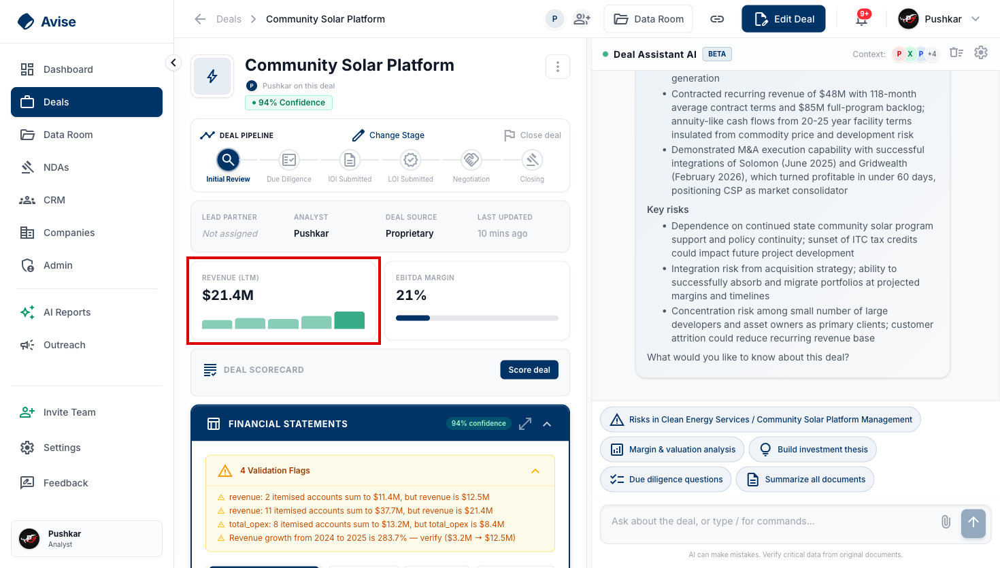
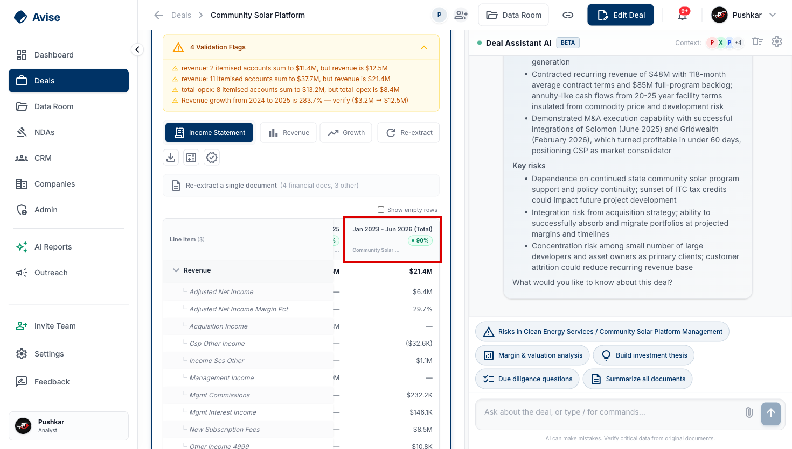
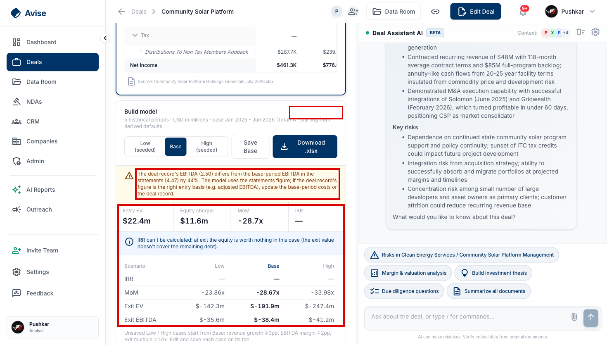

# Financial extraction: fix spec (from the 14 Oct 2026 live test)

**Who this is for:** the engineer fixing financial extraction. Start with fix A. It is small, and it clears the two critical bugs.

**Where it comes from:** one live extraction run on app.avise.io, deal "Community Solar Platform" (`4f257e8a-a73a-4de2-b28a-5455da0bc490`). All line numbers refer to `origin/main` at `b4ca41b6` (14 Oct 2026).

## Verdict

**The extractor reads numbers correctly, but the deal it updates ends up wrong.** All 24 FY2022–2025 figures checked match the source spreadsheet to the dollar. It also handled the same P&L appearing in both US$ and US$ thousands.

The bug is in what happens *after* the read:

- **A fake period.** The extractor stored a 42-month "Jan 2023 – Jun 2026 (Total)" column as a period. Downstream code treats it as the latest full year, so the deal card shows **Revenue (LTM) $21.4M instead of $12.5M**.
- **A broken model.** The deal model uses that same period as its base, so it shows **negative returns** (MoM −28.7x, Exit EV −$191.9m).
- **Lost projections.** All projections (H2 2026, FY2026E, FY2027) were silently dropped.

---

## Number check: 24 of 24 correct

**Source:** `Community Solar Platform Holdings Financials July 2026.xlsx`, tabs "Annual Summary + Projections" and "Consolidated IS". Values are in US$ thousands; the extracted values were stored in US$ millions and are converted here.

| Line item | 2022 src | 2022 got | 2023 src | 2023 got | 2024 src | 2024 got | 2025 src | 2025 got |
| --- | --- | --- | --- | --- | --- | --- | --- | --- |
| Revenue (Total Income) | 3,077 | 3,077 | 3,346 | 3,346 | 3,249 | 3,249 | 12,468 | 12,468 |
| Cost of revenue | 1,098 | 1,098 | 1,039 | 1,039 | 1,019 | 1,019 | 5,378 | 5,378 |
| Gross profit | 1,979 | 1,979 | 2,307 | 2,307 | 2,230 | 2,230 | 7,090 | 7,090 |
| Operating expenses | 1,517 | 1,517 | 1,530 | 1,530 | 1,735 | 1,735 | 4,593 | 4,593 |
| EBITDA (Adjusted) | 749 | 749 | 1,016 | 1,016 | 793 | 793 | 3,647 | 3,647 |
| Net income | 461 | 461 | 777 | 777 | 495 | 495 | 2,497 | 2,497 |

**Also correct:**
- **Unit scale.** It converted the thousands tab and the dollars tab correctly. This is the Luktara bug class, and it passed.
- **Detail kept.** Revenue split, payroll and each EBITDA addback were kept as separate rows, each with a source quote.
- **A genuine catch.** The validator flagged a real inconsistency in the file: 2025 Management + Acquisition income ($11.40M) does not equal the stated Total Income ($12.47M).

---

## Bugs, worst first

### 1. A fake 42-month period overwrites the deal card (critical)

The monthly tab has a "Total" column summing Jan 2023 – Jun 2026. It was stored as a HISTORICAL period, "Jan 2023 - Jun 2026 (Total)". `dealCacheWriteback` then chose it as the latest period and wrote revenue $21.4M and EBITDA $4.47M to the deal's cached columns. The correct FY2025 figures are $12.5M and $3.65M. The intake CIM read had already set the card correctly to $12.5M before extraction overwrote it.





Vercel log: `dealCacheWriteback: refreshed … cachedPeriod "Jan 2023 - Jun 2026 (Total)", cachedRevenue 21418461.71`.

### 2. The deal model builds on the fake period and shows negative returns (critical)

Build model reports its base as "Jan 2023 – Jun 2026 (Total) A". The outputs are:
- MoM −28.7x
- Exit EV −$191.9m
- Exit EBITDA −$38.4m
- IRR blank

`implausibleReturnsNote` (#196) doesn't fire, because it only checks high values (IRR > 100%, MoM > 20x).



### 3. All projections are silently dropped (high)

The run extracted 9 periods and stored only 5. The log says `Deep pass: dropped model-derived statements in favour of reported ones`. As a result, H2 2026, FY2026E and FY2027 were lost, and the UI says nothing about it.

### 4. Two different EBITDA figures for one deal (medium)

The CIM read sets deal EBITDA to $2.5M (reported). The spreadsheet gives $3.65M (Adjusted), stored under `ebitda`. The model then compares that against the cumulative $4.47M.

### 5. Four confidence numbers disagree (medium)

| Where | Value |
| --- | --- |
| Log | `Composite confidence: 73% (tier: low)` |
| API response | 88% |
| Each stored row | 95% |
| Deal page badge (green) | 94% |

### 6. No way to extract a single file on an empty deal (medium; costs money)

The empty Financials panel offers only the bulk "Extract Financials". On this deal that would run the expensive model 4 times. The per-file "Re-extract this document" button only appears after a first extraction.

### 7. Smaller issues

- **Auto-update default.** On Data Room uploads, "Auto-update deal with extracted data" is pre-ticked, which adds an AI call per file.
- **File types.** Types guessed from file names are wrong: the Master Customer Services Agreement became `NDA` and the Process Letter became `LOI`.
- **Slow.** Extraction took 218 s for a 57 KB, 6-tab workbook. That is 73% of the 300 s function limit.
- **Fast AI tier.** The fast tier defaults to OpenAI gpt-4o-mini, but production has no OpenAI key. Every AI function also logs "No LLM API key set … AI features disabled", even though Anthropic works.

---

## Fix spec, in priority order

Bugs 1 and 2 share **one root cause**, the shared period parser. Build every fix test-first: add the failing test, confirm it fails, then make the fix.

| # | Fix | Bugs | Size | Main files |
| --- | --- | --- | --- | --- |
| A | Stop cumulative "Total" ranges being read as a full year | 1, 2 | S | `packages/shared/src/periods.ts`, `apps/api/src/services/extraction/normalize.ts`, `extraction/extractionSchema.ts`, `dealModel/basePeriod.ts` |
| B | Warn on negative or zero returns, not only huge ones | 2 | XS | `apps/api/src/services/dealModel/scenarios.ts` |
| C | Keep projections when a model-derived statement is dropped | 3 | S | `apps/api/src/services/financialSourceSelection.ts` |
| D | Store Reported and Adjusted EBITDA separately | 4 | M | `extractionSchema.ts`, `dealCacheWriteback.ts`, web line catalogue |
| E | One confidence number everywhere | 5 | S | `financialAgent/nodes/storeNode.ts`, `financialAgent/index.ts`, `deal-layout.tsx` |
| F | Per-file extract on an empty deal | 6 | XS | `apps/web-next/src/app/(app)/deals/[id]/deal-financials.tsx` |
| G | Untick "Auto-update deal" by default | 7 | XS | `data-room/[dealId]/page.tsx`, `upload-helpers.ts` |
| H | Word-boundary file-type rules | 7 | XS | `routes/documents-upload.ts`, `routes/ingest-upload.ts` |
| I | Fast AI tier on Anthropic when there is no OpenAI key | 7 | XS | `apps/api/src/services/llm.ts`, `apps/api/src/openai.ts` |
| J | Cut extraction time well under 300 s | 7 | M | `extractionSchema.ts`, `extraction/claudeEngine.ts` |

### A. Cumulative "Total" ranges (bugs 1–2): do this first

**Root cause.** In `packages/shared/src/periods.ts`, the problem is these lines:

```ts
// lines 110-116
if (tokens.length >= 2 && last.year != null) {
  ...
  rangeMonths = last.year * 12 + last.month - (startYear * 12 + first.month) + 1;
  if (rangeMonths < 1 || rangeMonths > 24) rangeMonths = null;   // 42 months → null, endYear stays null
  else { endMonth = last.month; endYear = last.year; }
}
const year = endYear ?? findYear(u);                               // line 123 → last 4-digit year = 2026
...
return build('FY', 12, endMonth ?? fye, `${year}`);                // line 163 → a full FY2026
```

So the parser reads "Jan 2023 - Jun 2026 (Total)" as **FY2026** (ending 2026-12-31), which counts as newer than 2025. Three places then trust it:

- `apps/api/src/services/dealCacheWriteback.ts` `pickLatestForCache` (lines 93–127) sorts newest-first via `comparePeriodChronologically`, so it writes the Total into `cachedRevenue`/`cachedEbitda`. The deal card reads those (`deal-layout.tsx:222-235`, `deals-deal-card.tsx:67`).
- `apps/api/src/services/dealModel/basePeriod.ts` `isFullYearRow` (lines 41–55) accepts it as the last full year, which makes it the model base.
- `deals-financial-summaries.ts` uses the same picker.

**Change, in three layers:**

1. **Parser.** When a label has two or more month tokens and the span is over 24 months, return `null` (unparseable, so it sorts last). Treat labels containing `TOTAL`, `CUMULATIVE` or `ALL PERIODS` with a multi-year span the same way.
2. **Extraction post-processing** (`extraction/normalize.ts`, or `storeNode`). Drop periods whose parsed span is over 12 months, or whose label matches `/\b(total|cumulative)\b/i` and spans several years. Push a visible warning: `Skipped cumulative column "<label>"`. This runs after the model call, so re-testing hits the extraction cache and costs **$0**.
3. **Prompt** (`extractionSchema.ts`, near line 178: "One period entry per fiscal period column"). Add: "Do NOT emit Total, cumulative or all-period columns that sum several periods; emit only the individual fiscal periods."

As a backstop, make `isFullYearRow` reject labels matching `/total|cumulative/i`.

**Tests:**
- `apps/api/tests/canonical-periods.test.ts`: `parsePeriod("Jan 2023 - Jun 2026 (Total)")` is not FY / 12 months.
- `apps/api/tests/dealCacheWriteback.test.ts`: given rows 2024, 2025 and the Total, it picks 2025.
- `apps/api/tests/deal-model-base-period.test.ts`: the Total is never chosen as the base.
- `apps/api/tests/extraction-normalize.test.ts`: the Total column is dropped and the warning is added.

### B. Negative-returns guard (bug 2)

`dealModel/scenarios.ts` lines 150–170 flag only `irr > 1` or `mom > 20`, and receive only `irr`/`mom`. Widen the input to include `entryEv`, `exitEv` and `equity`. Flag any of these:
- `mom < 0`
- `exitEv <= 0`
- `entryEv <= 0`
- `equity <= 0`
- `irr < -1`

Use the message "Negative or zero exit value — check the base period and EBITDA".

**Test:** extend the `implausibleReturnsNote` tests in `apps/api/tests/financialUnitScale.test.ts` (lines 82–105).

### C. Keep projections (bug 3)

`financialSourceSelection.ts` lines 94–109 drop the whole `model_derived` statement whenever a `source_statement` of the same type exists:

```ts
if (kindOf(s) === 'model_derived' && typesWithSource.has(s.statementType)) { dropped.push(...); return false; }
```

That also throws away its PROJECTED periods when the source statement has none. Before dropping, keep the `periodType === 'PROJECTED'` periods the source doesn't already have. Either append them to the source statement or keep a projected-only copy. Historical duplicates stay dropped. Log what was salvaged.

**Test:** `apps/api/tests/financial-source-selection.test.ts`. Use a source IS with historicals plus a model-derived IS with historicals and projections. The historicals should drop; H2 2026, FY2026E and FY2027 should survive.

### D. Reported vs Adjusted EBITDA (bug 4)

There is no `adjusted_ebitda` canonical key. The vocabulary at `extractionSchema.ts:171` has only `ebitda` and `sde`, so the model puts Adjusted EBITDA under `ebitda`. Meanwhile the ingest read (`extraction/claudeDealReader.ts:116`) writes reported EBITDA to `Deal.ebitda` (`ingest-upload.ts:507-508,546`), so the two collide.

- Add `adjusted_ebitda` and `adjusted_ebitda_margin_pct` to the vocabulary.
- Tell the prompt: reported EBITDA goes in `ebitda`, the add-back figure in `adjusted_ebitda`.
- Keep `cachedEbitda` as reported, or add `cachedAdjustedEbitda`.
- Add the new keys to the allow-lists (`financialSchema.ts` and the web line catalogue).

**Tests:** `extraction-normalize.test.ts` and `extraction-schema-compat.test.ts`.

### E. One confidence number (bug 5)

| Number seen | Where it comes from | What happens to it |
| --- | --- | --- |
| Composite, 73% | `storeNode.ts:332-341` (`computeCompositeConfidence`) | Only logged; never stored or returned |
| Response `overallConfidence`, 88% | The model's self-score, `extraction/normalize.ts:167` | Returned to the caller |
| Row `extractionConfidence`, 95% | The model's per-period score, `normalize.ts:150`, stored at `financialExtractionOrchestrator.ts:301` | Stored on each row |
| Page badge, 94% | Average of the rows, `deal-layout.tsx:555-560` | Shown in green |

**Fix:**
- Persist the composite, per document or per row.
- Return it as `overallConfidence`.
- Make the badge read it, and turn the badge amber or red when the tier is low.

**Tests:** `store-node-source-match.test.ts` and `compositeConfidence.test.ts`.

### F–I. Quick fixes

- **F. Per-file extract on an empty deal.** In `deal-financials.tsx`, `hasData` (line 382) gates the whole panel, and lines 460–475 return only the empty state. Render `DealFinancialsReextractList` in the empty state too; `dealDocs` is already loaded. **Test:** `deal-financials-extract-all.test.ts`.
- **G. Auto-update default.** `data-room/[dealId]/page.tsx:178-179` forces the box on via `hasHighValueDoc`, which in `upload-helpers.ts:34-44` matches "cim", "teaser", "financial" or "model" anywhere in a file name. Default it to off. **Test:** `upload-helpers.test.ts`.
- **H. File types.** `documents-upload.ts:248-279` uses `includes('nda')`, which matches "sta**nda**rd", and `includes('letter')`, which matches "Process Letter".
  - Use `/\bnda\b|non[- ]?disclosure/` for NDA and `/\bloi\b|letter of intent/` for LOI.
  - Use `/\bdd\b/` for due diligence.
  - Merge the duplicate logic in `ingest-upload.ts:588-616` into one exported helper.
  - **Test:** a new unit test for that helper.
- **I. Fast AI tier.** `services/llm.ts:58` hard-defaults `fastProvider` to `'openai'`. Production has no OpenAI key, so `getFastModel` callers will throw. Those callers are `ai-portfolio.ts:271`, `memos-suggest.ts:60` and `followUpQuestions.ts:76`.
  - Default the fast provider to `'anthropic'` when Anthropic is the only key. As a stopgap today, set `LLM_FAST_PROVIDER=anthropic` in Vercel.
  - Quiet the warning at `openai.ts:78` when Anthropic is enabled.
  - **Test:** `llm-model-tiering.test.ts`.

### J. Extraction speed

The 218 s is mostly output volume:
- The schema (`extractionSchema.ts:131`) and the prompt (line 177) require `sourceQuote` and `sourcePage` on every line item.
- Every raw account line is reported (line 180), across 42 monthly columns.

The budget is `maxDuration = 300` in `apps/web-next/src/app/api/[...slug]/route.ts:24`. A failed check also triggers a second full repair call (`claudeEngine.ts:375-382`), which could push a run past 300 s.

**Fix:**
- For spreadsheets, make the quote a cell reference only.
- Skip monthly columns when annual columns exist.
- Skip the repair pass when more than ~150 s have elapsed.
- Log per-stage durations.

**Tests:** `financial-agent-timeout-signal.test.ts` and `extraction-schema-compat.test.ts`.

---

## Repair data already in production

After fix A ships, find every deal that holds a cumulative period. This query is read-only; the founder runs it in Supabase:

```sql
SELECT "dealId", "statementType", period, "extractionSource"
FROM "FinancialStatement"
WHERE period ~* '(total|cumulative)'
   OR period ~* '[a-z]{3} ?\d{4} ?- ?[a-z]{3} ?\d{4}';
```

For each deal it returns, including Community Solar Platform:
1. Delete the listed rows.
2. Click **Re-extract** on the workbook. This should be a free cache hit, and it rewrites the deal card.

## Definition of done (re-test on the Community Solar Platform deal, near-zero cost)

- [ ] The Revenue (LTM) tile shows **$12.5M**, and EBITDA matches FY2025.
- [ ] The statements table shows 2022–2025 plus H2 2026, FY2026E and FY2027 (projected), and has no "Total" column.
- [ ] Build model uses **FY2025** as its base, with positive MoM and a sane IRR. A negative case shows the new warning.
- [ ] Reported EBITDA ($2.5M) and Adjusted EBITDA ($3.65M) appear as separate lines.
- [ ] One confidence number, the same in the log, the API response and the badge.
- [ ] On a fresh deal, the empty Financials panel offers per-file extraction.
- [ ] The Master Services Agreement is typed OTHER/LEGAL, not NDA.
- [ ] Extraction finishes in under 150 s on this workbook.

---

## How the test was run (2 AI calls, about $1)

All times are 14 Oct 2026, UTC.

| Time | Action | AI used | Duration | Result |
| --- | --- | --- | --- | --- |
| 14:22 | Deal Intake: upload the CIM PDF only | 1 deal-overview read | 38 s | Deal created: Revenue $12.5M, EBITDA $2.5M, 92% confidence |
| 14:24 | Data Room: upload the other 6 files, auto-update unticked | none | ~20 s | All stored; types guessed from file names |
| 14:28 | Single-file extraction (`POST /deals/:id/financials/extract`, `{documentId, mode:"single"}`) on the Financials workbook | 1 Claude extraction | 218 s | 200 OK, 5 periods stored, 0 errors, 4 warnings |
| 14:32 | Open the deal page | none (panels read the cache only) | — | Wrong headline and model (bugs 1–2) |

**Vercel logs:**
- No errors and no 4xx/5xx in the window.
- The Excel text reader read all 6 tabs (37,089 characters).
- The Claude structured-output engine ran; its verify and cross-verify steps were skipped by design.

**Browser console:**
- Clean. The only red line was the expected `GET /api/folders/…/insights 404`, which means no insights have been generated yet.
- Opening the deal made no AI calls.

**Test files** (founder's Downloads, not committed):
- `Community Solar Platform CIM Q3 26.pdf`
- `Community Solar Platform Holdings Financials July 2026.xlsx` (the file extracted)
- `CSP_LBO_Model.xlsx`
- `CSP Sales Pipeline July 2026.xlsx`
- `CSP Call Transcript.pdf`
- `CSP Process Letter Q3 2026.pdf`
- `Standard CSP Master Customer Services Agreement - Template.pdf`
