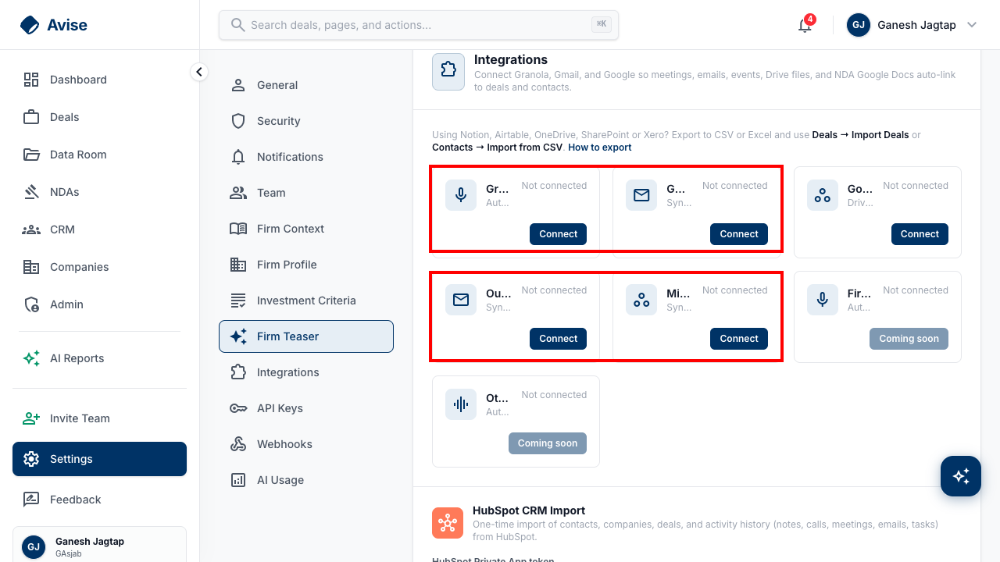

# Fix report: Integrations name truncation + Data Room folder 404

Written for an engineer to review/merge the PR, or to understand why the second item isn't one.

---

## 1. Integrations page: provider names truncated to 1-3 characters — FIXED, PR open

**PR:** https://github.com/PocketFundTech/pe-dealstack/pull/216 (`fix/integrations-name-truncation` → `main`)

### The bug

At `lg:grid-cols-3` (the breakpoint that kicks in around 1280px, a standard laptop width), every integration card in Settings > Integrations showed an unreadable, truncated name: "Gr...", "G...", "Go...", "Ou...", "Mi...", "Fir...", "Ot..." instead of Granola, Gmail, Google, Outlook, Microsoft 365, Fireflies, Otter.



### Root cause (confirmed by live DOM measurement, not guessed)

`apps/web-next/src/app/(app)/settings/IntegrationsSection.providerCard.tsx` rendered the icon, the name/description block, and the status badge ("Connected" / "Not connected") all in **one flex row**:

```tsx
<div className="flex items-start justify-between gap-3">
  <div className="flex flex-1 items-center gap-3 min-w-0">
    <div className="w-10 h-10 ... shrink-0">{icon}</div>
    <div className="min-w-0">
      <div className="... truncate">{provider.name}</div>
      ...
    </div>
  </div>
  {badge ? <span className="... shrink-0">{badge.label}</span> : <span className="... shrink-0">Not connected</span>}
</div>
```

At this breakpoint each card is only ~215px wide. The icon (40px, `shrink-0`) and the status badge (~70-95px, `shrink-0`) both refuse to shrink, so the `flex-1 min-w-0` name block — which **does** shrink — was squeezed down to as little as **34px**, measured directly on the live page:

```js
// from the browser console, on app.avise.io/settings#integrations at 1280px:
"Granola" width=34 scrollWidth=53 truncated=true
"Gmail" width=34 scrollWidth=38 truncated=true
"Microsoft 365" width=34 scrollWidth=95 truncated=true
```

### The fix

Moved the status badge out of that row, onto its own line below the icon+name block. Now the name only competes with the icon (40px) for space within the ~215px card — roughly 150-170px available, which comfortably fits every current provider name including the longest ("Microsoft 365" needs ~95px).

```tsx
<div className="flex items-center gap-3 min-w-0" data-testid="provider-name-row">
  <div className="w-10 h-10 ... shrink-0">{icon}</div>
  <div className="min-w-0 flex-1">
    <div className="... truncate">{provider.name}</div>
    ...
  </div>
</div>
<div>
  {badge ? <span>{badge.label}</span> : <span>Not connected</span>}
</div>
```

### Testing done

- New regression test (`IntegrationsSection.providerCard.test.tsx`): asserts the status badge is never a descendant of the name's row, for both the "connected" and "not connected" states. Verified **red → green**: fails against the pre-fix layout (reverted and re-ran), passes against the fix.
- Full `apps/web-next` test suite: 600/602 pass; the 2 failures are pre-existing and unrelated (confirmed identical on a clean `main` worktree before this change — not caused by this fix).
- `tsc --noEmit`: only 2 pre-existing, unrelated errors (a missing build artifact in a fresh git worktree that hasn't built `apps/api` yet); nothing in the changed files.

**Status: code complete, PR #216 open, not yet merged.** Someone needs to review and merge it.

---

## 2. Silent 404 on `GET /api/folders/{id}/insights` — NOT a bug, no fix needed

**No PR.** This was downgraded after investigation — here's why, so it isn't re-reported.

### What it looked like

Opening a Data Room folder fires `GET /api/folders/{id}/insights`, which returns HTTP 404 and shows up as a red error line in the browser console/Network tab. This was originally flagged as a bug in `docs/QA-REPORT-2026-10-06.md` (#10).

### Why it isn't a bug

The backend (`apps/api/src/routes/folders-insights.ts`) returns 404 **on purpose** when a folder has no AI-generated insight yet — that's standard, correct REST usage ("this resource doesn't exist yet"), not a broken endpoint:

```ts
if (error) {
  if (error.code === 'PGRST116') {
    return res.status(404).json({ error: 'No insights found for this folder' });
  }
  throw error;
}
```

And the frontend (`apps/web-next/src/lib/vdr/api.ts`) already catches this exact case and treats it as the normal "nothing generated yet" state, with an explicit comment saying so:

```ts
// 404 just means no insights yet — that's the normal state for folders
// that haven't had insights generated. Stay silent for those.
```

The UI correctly shows the right empty state either way. The **only** thing happening is that Chrome's DevTools logs any non-2xx HTTP response to the console/Network panel by default — that's browser behavior, not something the app can suppress while still using a 404 status code.

### If you want to get rid of the console noise anyway

The only way to make this not show as a 404 in DevTools is to change the API contract: have the backend return `200` with an empty/null body instead of `404` when there's no insight yet, and update the frontend to check for an empty payload instead of catching a 404. That's a real (if small) API contract change, not a one-line fix, and it trades a semantically-correct status code for a cosmetic DevTools improvement. Recommend leaving this alone unless the console noise is actually causing confusion during other debugging — happy to make that change if you want it, just flagging it's a deliberate trade-off, not a bugfix.
