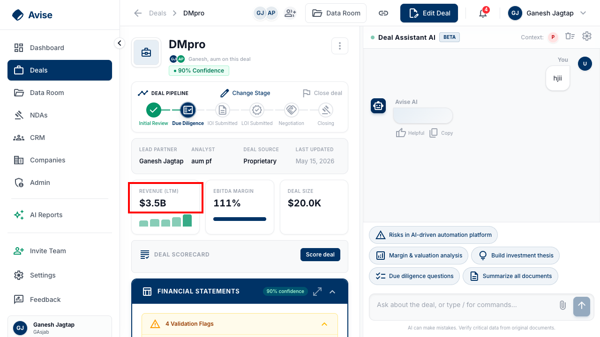

# QA Report — 2026-10-11 (follow-up sweep)

Re-verification pass across all main pages of app.avise.io, following up on `docs/QA-REPORT-2026-10-06.md`. Logged in as the real account (the founder's real account, org "GAsjab", 16 live deals). Methodology: `docs/QA-TESTING-MASTER-PROMPT.md`.

**What changed since 2026-10-06:** a new "Companies" page has shipped (not covered in the previous report — tested fresh below). Several previously-reported bugs are now fixed.

---

## Summary

| From 10-06 report | Status today |
|---|---|
| #1 — Balance sheet doesn't balance (Luktara) | 🟡 Unchanged — root-cause fix (PR #196) still open/unmerged |
| #2 — No mobile navigation | 🔴 **Still broken** — re-confirmed below, more precisely this time |
| #3 — "Pocket Fund" stale branding | ✅ **Fixed** — verified in both locations |
| #4 — Feedback → "PE OS Beta" form | 🔴 **Still broken** — re-confirmed |
| #5 — Settings scroll-spy | ⚪ Not re-tested this round |
| #6 — React hydration error #418 | ✅ **Fixed** — re-confirmed across 2 reloads |
| #7 — Integrations truncated names | 🔴 **Still broken** — re-confirmed |
| #8 — Team invite no feedback | ⚪ Not re-tested this round |
| #9 — "Change Stage" opens "Close Deal" | ✅ **Fixed** — now opens the correct stage picker |
| #10 — Silent 404 on folder insights | 🔴 **Still broken** — re-confirmed |
| #11 — Unit-scale model bug (Luktara) | 🟡 Unchanged — see new finding #21 below, same bug on a second deal |
| #12 — Raw AI error in memos/PDFs | ⚪ Not re-tested this round (same root cause as before, no reason to expect it changed) |
| #13 — Client portal watermark/revoke gap | ⚪ Not re-tested this round |
| #14 — NDA/Google dependency | ⚪ Not re-tested this round |
| #15 — Dashboard "New deal" button dead | ✅ **Fixed** — opens Ingest Deal Data correctly |
| #16 — Memo Builder 1280px/duplicates/PDF | ⚪ Not re-tested this round |
| #17 — Tablet 768px layout | ⚪ Not re-tested this round |
| #18 — Workspace creator gets MEMBER role | ⚪ Not re-tested this round |
| #19 — Gmail/Google OAuth | ✅ Already fixed (verified 2026-10-06) |
| **NEW #21** — Second instance of unit-scale bug, worse (impossible EBITDA margin) | 🔴 New finding |
| **NEW #22** — Companies page (new feature) | ✅ Clean, no bugs found |

**Net new fixes since 10-06: #3, #6, #9, #15 (four real fixes, all verified).**
**Still open and re-confirmed today: #2, #4, #7, #10.**
**New finding: #21 — the unit-scale extraction bug (originally #11) is not isolated to Luktara.**

---

## 21. NEW — Second confirmed instance of the unit-scale bug, worse than Luktara's

**Status: 🔴 Open. Same root cause as #11 (PR #196), different symptom.**

Opened **DMpro** (Due Diligence stage, "AI-driven automation platform... Twitter outreach", deal size **$20.0K**). The deal header tiles show:

- **Revenue (LTM): $3.5B**
- **EBITDA Margin: 111%** — mathematically impossible, a margin cannot exceed 100%, and this is shown as a plain headline number with no warning indicator on the tile itself.



Unlike Luktara (a clean ~1,000x jump between two adjacent years), this one is messier — the single source document (`CIM - DMPRO.docx.pdf`) produced wildly swinging **monthly** figures for a tiny company:

```
Sep 25: $49.0M → Oct 25: $294.0M (+500%) → Nov 25: $98.0M → Dec 25: $653.0M (+566%)
→ Jan 26: $2.1B (+220%) → Feb 26: $517.0M → "6 months" total: $3.5B (+584%)
```

The existing validator **does** correctly flag each of these jumps as a "Revenue growth X% — verify" warning — so the detection logic is working at the line level. But:
1. These are marked **warning**, not **error**, even though a swing from $49M to $2.1B and back down for a $20K deal is not a plausible warning-level anomaly — it's certain to be wrong.
2. Nothing stops the headline **EBITDA Margin 111%** tile from being displayed as a plain number. A margin over 100% should be an unconditional red flag (it's definitionally impossible, not just "unusually high"), regardless of whether it stems from a unit-scale issue or something else.

**Fix direction:**
- Add a hard sanity check independent of the unit-scale-break heuristic from PR #196: EBITDA margin outside roughly -50% to 100% should never render as a plain headline number without a warning badge — this doesn't require detecting *why* it's wrong, just that a margin >100% is never valid.
- Consider: when a single document's extracted monthly figures imply >400% swings in both directions within the same 6-month window, that's a strong independent signal (distinct from the clean power-of-1000 pattern #196 targets) worth its own validation rule.
- This confirms #11 isn't a one-off — worth running a quick audit across all 16 deals' extracted financials for the same class of issue before considering the unit-scale problem closed, even after PR #196 merges.

---

## 22. NEW — Companies page (shipped since 2026-10-06, not in previous report)

**Status: ✅ Clean — no bugs found.**

A new left-nav item, "Companies" (between CRM and Admin), lists every company across deals/contacts/HubSpot imports (16 companies) with industry, website, linked deals, and contact counts. Tested:
- List view loads with no console errors, clean table, working search/filter/sort controls.
- Clicking a company opens a side-panel detail view (industry, website, description, linked deals, linked contacts) with a correct empty-state explanation ("No contacts list this company. Contacts are matched by the company name on the contact.") — matches the product's own "explain every empty state" standard.
- No issues found in this feature. Not exhaustively tested (didn't test creating/editing a company), but the read path is solid.

---

## Re-confirmed still-open findings (evidence refreshed 2026-10-11)

### #2 — No mobile navigation
At 390×844, all 8 sidebar nav links (Dashboard, Deals, Data Room, NDAs, CRM, Companies, Admin, AI Reports) exist in the DOM but render at `visible=false, x=0, y=0` — confirmed via `getComputedStyle`/`getBoundingClientRect`, not just visual inspection. No hamburger menu or alternate mobile nav exists anywhere on the page. A phone user is stuck on whatever page they land on.

### #4 — Feedback still links to "PE OS Beta Feedback Form"
Re-clicked from Settings; opened tab is still titled "PE OS Beta Feedback Form" (same Google Form URL as 10-06).

### #7 — Integrations page still shows truncated names
Settings > Integrations: "Gr...", "G...", "Go...", "Ou...", "Mi...", "Fir...", "Ot..." — identical to the 10-06 finding, unaffected by the Gmail/Google OAuth backend fix that shipped between the two reports (that fix was server-side routing only, not the CSS truncation bug).

### #10 — Silent 404 on folder insights
Opened a Data Room folder; `GET /api/folders/{id}/insights` still returns 404 in the console, UI still silently shows the correct empty state regardless.

---

## Newly confirmed fixes (evidence captured 2026-10-11)

### #3 — "Pocket Fund" branding — fixed
Admin > Command Center > Security now reads "Avise staff accessed your data." (was "Pocket Fund staff..."). Settings > AI Usage no longer contains the string "Pocket Fund" anywhere (checked via `document.body.innerText.includes('Pocket Fund')` → `false`).

### #6 — React hydration error #418 — fixed
Dashboard and Data Room loads produce zero console errors, confirmed across two separate page loads (including a hard reload) with explicit error-log checks each time. Previously 100% reproducible.

### #9 — "Change Stage" button — fixed
Clicking the deal-page "Change Stage" button now correctly opens "Change Deal Stage" (e.g. Due Diligence → IOI Submitted) with the right before/after preview — not the "Close Deal" (Won/Lost/Passed) dialog it used to open. The mislabeled-control bug is resolved; the button now does what it says.

### #15 — Dashboard "New deal" button — fixed
Clicking "New deal" in the Dashboard header now correctly opens the Ingest Deal Data flow. Previously did nothing on click or Enter.

---

## Not re-tested this round (scope/time, not blocked)

#5 (scroll-spy), #8 (invite feedback), #12 (raw AI error in memos), #13 (client portal watermark/revoke), #14 (NDA/Google dependency), #16 (Memo Builder layout/duplicates/PDF), #17 (tablet 768px), #18 (workspace-creator role). No reason to assume these changed — they weren't touched by anything in this session's visible fix set (#3, #6, #9, #15 all look like small, targeted fixes, not a broad refactor that would incidentally touch these other areas). Recommend re-verifying each the same way before assuming they're still open or still fixed.

---

*Compiled 2026-10-11 using the methodology in `docs/QA-TESTING-MASTER-PROMPT.md`, continuing from `docs/QA-REPORT-2026-10-06.md`.*
